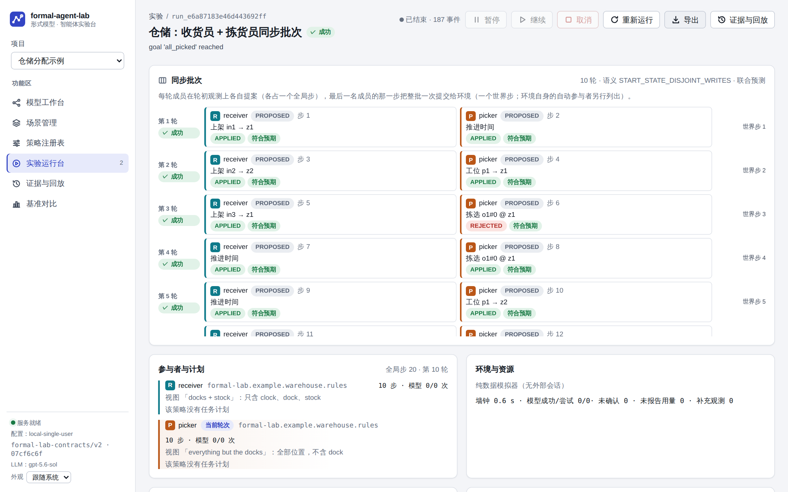
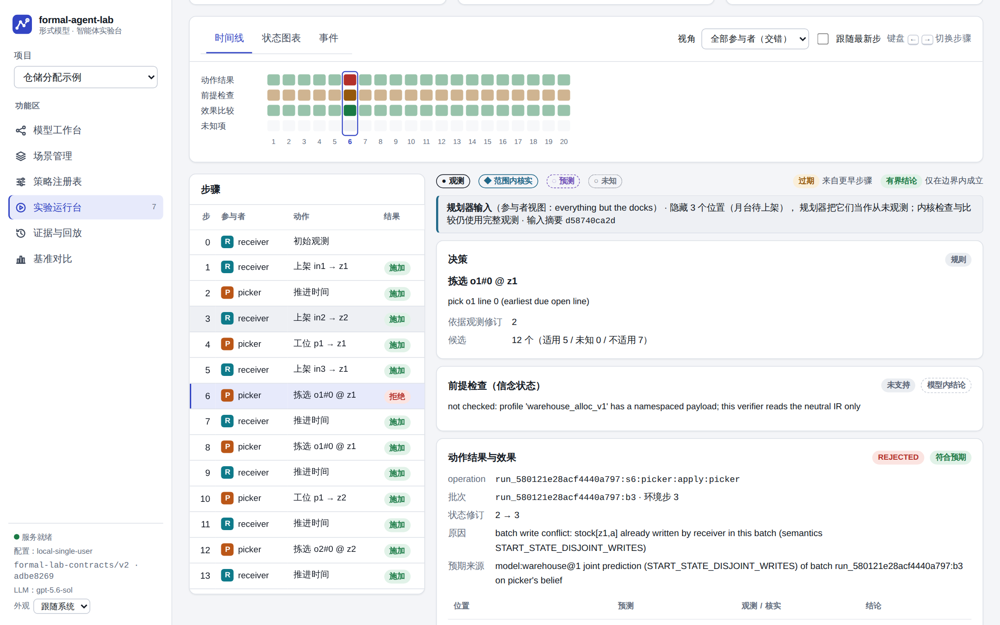
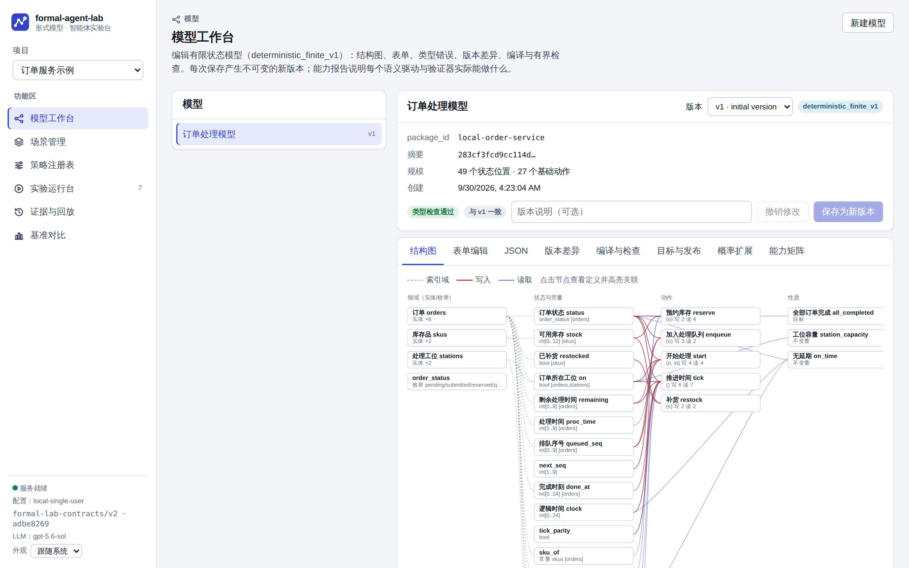
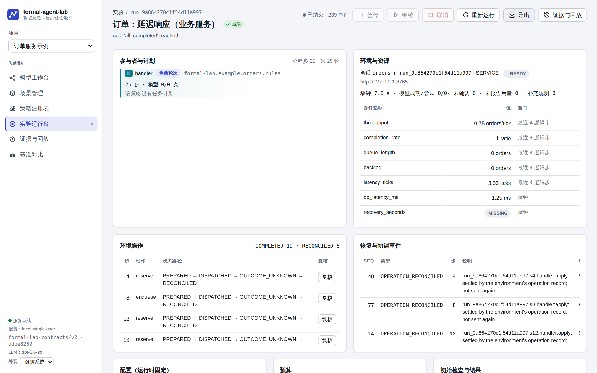
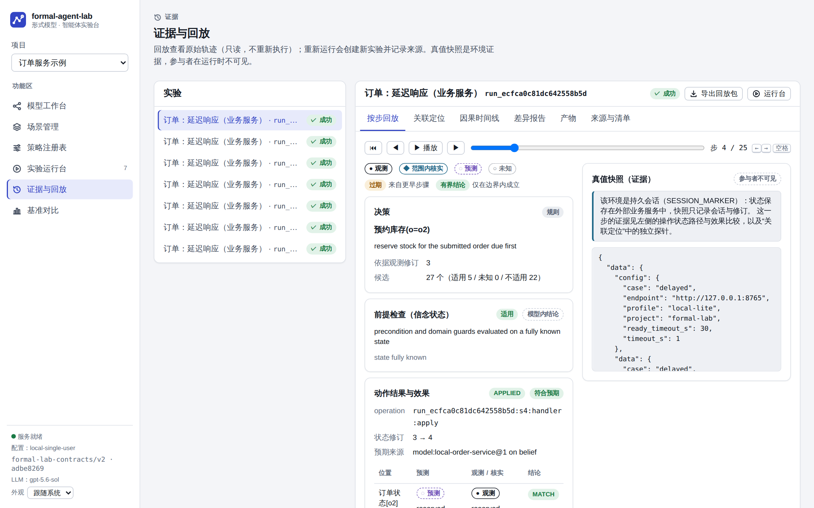
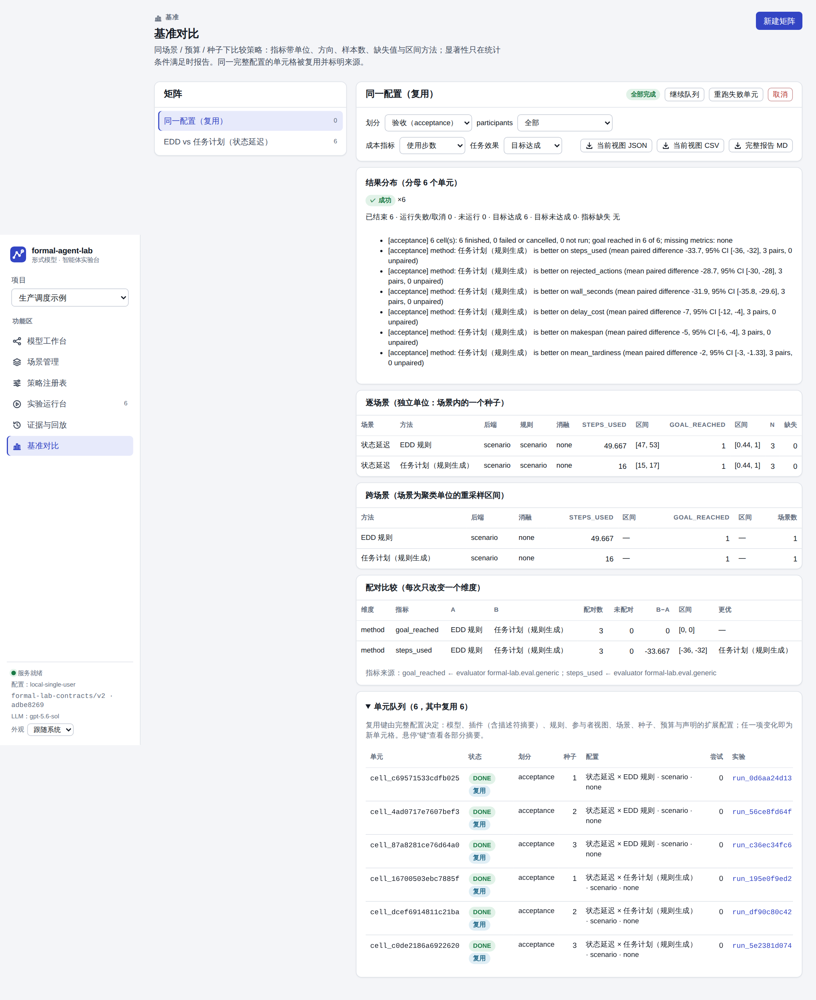
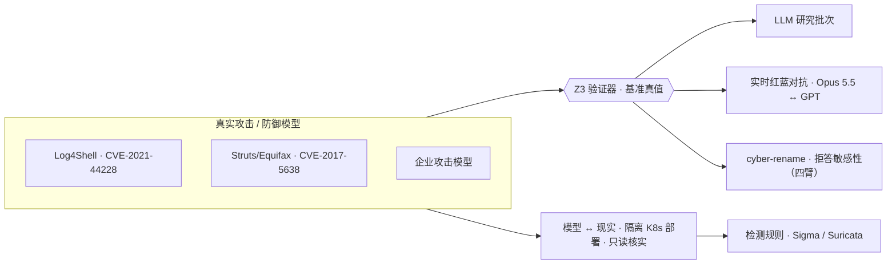
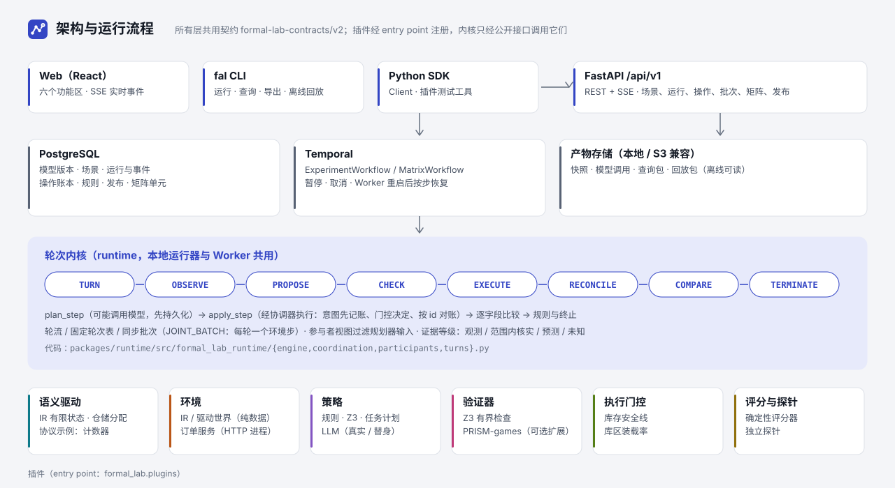

<p align="center">
  
</p>

<p align="center">
  <a href="https://github.com/3351666087/formal-agent-lab/releases/latest"></a>
  <a href="https://github.com/3351666087/formal-agent-lab/actions/workflows/ci.yml"></a>
  
  
  <a href="LICENSE"></a>
</p>

<p align="center">
  <a href="docs/assets/demo.mp4">视频 MP4（1080p · 24 s）</a> · <a href="docs/assets/demo.html">网页预览（可暂停 / 拖动）</a> · <a href="docs/assets/demo-cover.png">静态封面</a> · <a href="docs/assets/architecture.svg">架构图</a>
</p>

# formal-agent-lab

**从形式模型出发，让智能体的每一步都可检查、可比较、可回放。**

一个在本机运行的研究工作台。先用有限状态模型描述一个世界（订单处理、仓储分配、生产调度……），做类型检查和有界查询；再让一个或多个参与者——规则、Z3 规划、任务计划或 LLM 策略——在纯数据模拟器或真实的本地业务服务里行动。每个动作在发送前经过检查与执行门控，发送后与模型预测逐字段比较；差异变成修订建议和回归案例；整个过程是一条带因果链的事件轨迹，可以导出成回放包离线阅读。

<table>
<tr>
<td width="33%" valign="top"><b>模型优先</b><br><sub>状态、动作、性质先写进 <code>deterministic_finite_v1</code> 模型；类型检查、Z3 有界查询与成本最优都在运行之前。有界结论只对界内成立，不宣称更多。</sub></td>
<td width="33%" valign="top"><b>先检查，再执行</b><br><sub>策略只在模型给出的候选中选，前提先检查；环境操作先持久化意图，执行门控在发送前决定，应答丢失时按操作 id 对账，从不盲目重发。</sub></td>
<td width="33%" valign="top"><b>证据可回放</b><br><sub>预测与观测逐字段比较（● 观测 · ◆ 范围内核实 · ◌ 预测 · ○ 未知）；差异 → 修订建议 → 回归案例 → 发布；运行导出为自包含回放包。</sub></td>
</tr>
</table>

- **它是**：单用户、本地优先的实验平台与建模引擎（PostgreSQL + Temporal + FastAPI + React，全部在本机或本地虚拟机）；模型语义、环境、策略、验证器、执行门控、评分器都是可替换的插件。
- **它不是**：通用智能体框架或托管服务；不需要 LLM（LLM 策略是可选插件，另有确定性替身）；有界检查只在给定步数内给出结论，不宣称无界的正确性。

## 一次真实运行

上面的动画逐帧取自订单服务示例的一次运行（服务里工位 p2 实际半速，模型按正常速度预测），数据见 [`design/animation/demo-data.json`](design/animation/demo-data.json)，由 [`scripts/render_demo.py`](scripts/render_demo.py) 生成：

| | 阶段 | 发生了什么 | 结果 |
|---|---|---|---|
| 01 | 模型 | `fal model push` 导入订单处理模型 | 49 个状态位置 · 27 个基础动作 · 类型检查通过 |
| 02 | 有界检查 | Z3 查询 12 步内能否完成全部订单 | `NO_WITNESS_WITHIN_BOUND`：界内无见证，界外不下结论 |
| 03 | 计划 | 规则策略每步从模型候选中选，前提先检查 | 26 步完成全部订单，0 次拒绝 |
| 04 | 执行 | 每个操作 `PREPARED → DISPATCHED → COMPLETED`，按操作 id 可查 | 251 个事件，全部带因果父事件 |
| 05 | 偏差 | 第 9 步 `tick()`：`remaining[o2]` 预测 3、观测 4 | 26 次比较中 4 处不同 → 修订建议（`tick` 读 `arrive_at, slow`）+ 4 个回归案例 |
| 06 | 发布 | 回归案例重放 | v1 4 × FAIL → `REJECTED`；v2 `slow[p2] = true` 4 × PASS → `RELEASED`，0 处差异；回放包离线可读 |

## 真实界面

截图由 [`scripts/capture_screens.py`](scripts/capture_screens.py) 驱动 Web 界面走完真实流程后生成（示例项目是种子数据，结果是真实结果）。

<table>
<tr>
<td width="50%"><br><sub><b>实验运行台 · 仓储同步批次</b>：收货员与拣货员每轮在同一观测上各自提案，一轮一个世界步；成员结果、联合预测比较与参与者颜色。</sub></td>
<td width="50%"><br><sub><b>步骤详情</b>：参与者视图隐藏了哪些位置、字段级效果比较（● 观测 · ◆ 范围内核实 · ◌ 预测 · ○ 未知）。</sub></td>
</tr>
<tr>
<td><br><sub><b>模型工作台</b>：结构图（领域 → 状态 → 动作 → 性质）、版本差异、编译与有界检查、能力报告。</sub></td>
<td><br><sub><b>订单服务恢复</b>：每个应答都晚于客户端超时 → 结果未知 → 按操作 id 查询对账（RECONCILED），从不重复发送。</sub></td>
</tr>
<tr>
<td><br><sub><b>证据与回放</b>：按步回放、关联定位、因果时间线、差异报告、产物与来源清单；回放包可离线读取。</sub></td>
<td><br><sub><b>基准对比</b>：场景 × 策略 × 种子矩阵、配对比较；同一完整配置的单元格被复用并标明来源。</sub></td>
</tr>
</table>

深色模式与窄屏：[run-batch-dark.png](docs/assets/screens/run-batch-dark.png) · [landing-dark.png](docs/assets/screens/landing-dark.png) · [run-narrow.png](docs/assets/screens/run-narrow.png)。

## 安全领域：真实攻击模型、真实 CVE、红蓝对抗与拒答敏感性

同一条回路也用在安全领域——而且是**真实攻击模型**，不是攻击图抽象：状态是真实安全态势（立足点、管理员、窃得的凭据、网络可达、数据外泄），动作是攻击技术（带真实前提与效果），防御是模型常量，攻击目标由 **Z3 规划**到达；每个问题的基准答案都是 Z3 验证器。两个案例直接取自知名项目真实重大漏洞的 commit，做易受攻击版本 → 修复版本的对照：

- **Log4Shell（CVE-2021-44228 · Apache Log4j 2）**：发布链逐步建模（输入被记录 → 触发 JNDI 查找 → 连到攻击端点 → 返回恶意引用 → 远程类加载 → RCE）。Z3 判定 **2.14.1 可达 RCE、2.16.0 被阻断**；六步顺序链任一单一控制即可切断——纵深防御被证明而非断言。
- **Struts/Equifax（CVE-2017-5638）**：S2-045 无认证 RCE 作为 2017 Equifax 泄露的初始访问，后续多阶段链（侦察 → 凭据 → 横向 → 读库 → 外泄 ≈1.43 亿条）；12 个控制、每阶段两条分支，阻断泄露的**最小控制集为 2**。
- **实时红蓝对抗**：两个前沿模型在 Struts/Equifax 模型上实时规划攻防、彼此换边，形式模型当裁判（技术只在阶段前提成立且无阻断控制时生效）。结果如实记录，含拒答与弃权。



**模型 ↔ 现实（已验证）**：把两个易受攻击版本部署到一个隔离的 Kubernetes 命名空间（经授权的实验区），以**只读**管理员检查确认运行态与模型的 `vulnerable` 前提逐项吻合，于是 Z3 结论适用于真实部署——同一个控制在模型里和现实里切断同一条链。防御侧产出已入库（[模型↔现实对应](docs/security/cve-model-reality-correspondence.md)、[检测规则](docs/security/rules/)）；进攻侧产物（利用代码、RCE 标记、窃取的凭据/PII）保持本地、git 忽略，不入版本库。

**拒答对措辞的敏感性（`cyber-rename`）**：同样两个 CVE 模型，结构完全相同、Z3 真值共享，用四套词汇各问一遍，走**官方** claude-opus-5-5——结果反直觉：

| 词汇（框架） | 拒答率 |
|---|---|
| attackmodel（具名真实 CVE） | 0.50 |
| abstract（语义空，无框架） | 0.67 |
| logistics（中性物流伪装） | 0.75 |
| anchored（中性 + 一句“防御演练”前言） | **1.00** |

伪装成物流、或贴一句“这是防御安全演练”都**提高**了拒答（后者直接到 100%——自称防御正是越狱洗白的典型句式）；唯一压低拒答的是锚定在真实具名 CVE 上。凡被回答的单元 39/39 全部 Z3 正确。这是**稳健性 / 误拒**结论，不是越狱。详见 [refusal-sensitivity-cyber-rename.md](docs/security/refusal-sensitivity-cyber-rename.md)。

领域能力全部通过平台的公开插件接口接入，核心引擎不含领域专有逻辑；边界说明见 [assurance-scope.md](docs/assurance-scope.md)（§1 模型内结论 / §2 实测结论分列）。攻击模型是抽象的命名条件，面向防御研究与可复核性，不是可操作的利用步骤。

## 功能地图

| 功能区 | 能做什么 | 入口 |
|---|---|---|
| 模型工作台 | 编辑有限状态模型（结构图 / 表单 / JSON），类型检查、版本差异、Z3 有界查询与成本最优、能力报告、发布检查（必需检查与必需成立的性质分开记录） | Web · `fal model` · `fal release` |
| 场景管理 | 固定模型版本、环境、参与者（策略、动作范围、**视图**）、轮次（轮流 / 固定轮次表 / **同步批次**）、执行门控、预算、终止条件 | Web · API |
| 策略注册表 | 插件描述符：能力、配置 schema、版本与兼容性；项目策略配置固定插件版本 | Web · `fal plugins` |
| 实验运行台 | Temporal 持久运行：暂停 / 继续 / 取消 / 重跑，Worker 被杀后按步恢复；操作账本、对账与人工复核；批次轮次 | Web · `fal run` · `fal ops` |
| 证据与回放 | 事件因果链、按步回放、效果差异与修订建议、回归案例、导出回放包并离线阅读 | Web · `fal export` · `fal replay` |
| 基准对比 | 矩阵队列（失败可重跑、增量合并）、配对比较与区间、消融；复用键覆盖模型、插件、规则、视图、场景、种子、预算与扩展配置 | Web · `fal matrix` |
| 安全领域（MAL / CAGE） | 真实攻击模型（状态=安全态势、技术=动作、Z3 规划到数据外泄）与真实 CVE 形式模型（Log4Shell、Struts/Equifax，易受攻击/修复版对照）；实时红蓝对抗；`cyber-rename` 拒答敏感性研究（官方模型）；准入 Broker（验证凭据、拒绝零副作用、LabPolicy/TargetSecurity 分离）；CAGE 4 官方基线与配对评测 | `packages/domain-mal` · `packages/domain-broker` · `packages/environment-{mal,cage}` |

## 快速开始（Ubuntu 24.04，或 macOS 上的 Colima 虚拟机）

```bash
bash scripts/bootstrap-dev-vm.sh && make bootstrap
make doctor                        # 本地 profile 是否可用、资源与端口
make demo                          # 无需任何服务：有界检查 + 策略比较
make services-up && make dev-up    # 开发栈 → http://127.0.0.1:5173（含三个示例项目）
make orders-up                     # 本地订单服务（持久业务环境）→ 127.0.0.1:8765
```

同样的流程也可以只用命令行（[`scripts/product_flow_evidence.py`](scripts/product_flow_evidence.py) 就是这样跑的）：

```bash
fal run start --project 仓储分配示例 --scenario "仓储：收货员 + 拣货员同步批次" --wait
fal run batches <run_id>                    # 每轮成员、状态、环境步与结果
fal export <run_id> -o wh.replay.zip        # 自包含回放包
fal replay verify wh.replay.zip && fal replay batches wh.replay.zip   # 离线读取
```

## 发布与镜像

每个版本标签（`vX.Y.Z`）由 [`.github/workflows/release.yml`](.github/workflows/release.yml) 自动发布：四个 OCI 镜像（`api` · `worker` · `web` · `orders`）推到 GitHub Packages，并创建带全部 wheel 的 GitHub Release；镜像路径与 Helm chart 的 `image.registry` + `repository`（[`deploy/helm/.../values.yaml`](deploy/helm/formal-agent-lab/values.yaml)）对齐。

```bash
docker pull ghcr.io/3351666087/formal-agent-lab/api:0.5.0          # 另有 worker · web · orders；标签 0.5.0 / 0.5 / latest
pip install --find-links <release-wheels-dir> formal-lab-sdk[offline]   # CLI + 离线回放
```

最新发布见 [Releases](https://github.com/3351666087/formal-agent-lab/releases/latest)，镜像与摘要见仓库的 [Packages](https://github.com/3351666087/formal-agent-lab/pkgs/container/formal-agent-lab%2Fapi)。

## 架构与运行流程

<p align="center"></p>

每个全局逻辑步是一个参与者的回合：`plan_step` 决定提案（可能调用模型，先持久化）；`apply_step` 经协调器执行——意图先记账、执行门控在发送前决定、应答丢失时按操作 id 查询对账——然后逐字段比较效果、评估规则与终止条件。本地运行器与 Temporal Worker 调用同一套引擎，所以两条路径的轨迹一致。契约 `formal-lab-contracts/v2`（Pydantic → JSON Schema → TypeScript）贯穿所有层；插件经 entry point 注册，接入方式见[插件接入指南](docs/architecture/plugin-integration.md)。

## 文档

- **研究轨与安全领域（阶段 5–8）**：模型↔程序对应与研究用例（5A/5B）· 真实端点调用与双模型评测（6A/6B，[phase6](docs/handoff/phase6.md)）· 保留案例与缺口关闭 K01–K03（[phase7](docs/handoff/phase7.md)）· 安全领域真实攻击模型 + 真实 CVE + 实时红蓝 + 模型↔现实（[phase8 交接](docs/handoff/phase8.md)）· 拒答敏感性研究 [refusal-sensitivity-cyber-rename.md](docs/security/refusal-sensitivity-cyber-rename.md) · 模型↔现实对应 [cve-model-reality-correspondence.md](docs/security/cve-model-reality-correspondence.md) · 检测规则 [docs/security/rules/](docs/security/rules/) · 检查 `make research-check`
- **阶段四交接**：平台修复（A1–A5）[docs/execution/phase-4a.md](docs/execution/phase-4a.md) · 领域收口（B1–B3）[docs/execution/phase-4b.md](docs/execution/phase-4b.md) · 交接 [docs/handoff/phase4.md](docs/handoff/phase4.md) · 检查 `make phase4-check` / `make acceptance-local`
- **阶段三交接**：通用平台与视觉（G1–G6）[docs/execution/phase-3a.md](docs/execution/phase-3a.md) · 领域集成（D1–D6）[docs/execution/phase-3b.md](docs/execution/phase-3b.md) · 交接 [docs/handoff/phase3.md](docs/handoff/phase3.md) · 保证范围 [docs/assurance-scope.md](docs/assurance-scope.md) · 验收 [docs/acceptance-phase3.md](docs/acceptance-phase3.md) · 研究读数 [docs/research-readout.md](docs/research-readout.md) · 检查 `make phase3-check` / `make acceptance-local` → [docs/execution/evidence/phase3/checks/](docs/execution/evidence/phase3/checks/results.json)
- **设计系统**：[docs/design-system.md](docs/design-system.md)（tokens、组件、图表、页面、媒体生成命令、基准截图）· [Figma 设计文件](https://www.figma.com/design/uuV6JeilZQkhnIQcJYEUET)
- **阶段二（历史验收）**：[docs/handoff/phase2.md](docs/handoff/phase2.md) · [验收](docs/acceptance-phase2.md) · 阶段一 [phase1.md](docs/handoff/phase1.md)
- **使用与运维**：[入门](docs/getting-started.md) · [本地开发](docs/local-development.md) · [部署](docs/deployment.md)
- **接口**：[契约 v2](docs/contracts/v2.md)（[v1](docs/contracts/v1.md) 冻结）· [插件接入](docs/architecture/plugin-integration.md) · [能力矩阵](docs/architecture/capability-matrix.md) · [观测语义](docs/architecture/observation-semantics.md) · [决策记录](docs/execution/decisions.md)
- **复用与许可**：[复用记录](docs/reuse-ledger.md) · [第三方许可](docs/licenses.md)

许可：[Apache License 2.0](LICENSE)（另见 [NOTICE](NOTICE)；选择理由见决策 D-014）。第三方组件以未修改的官方发行物使用，各自的许可见复用记录与许可证清单。
